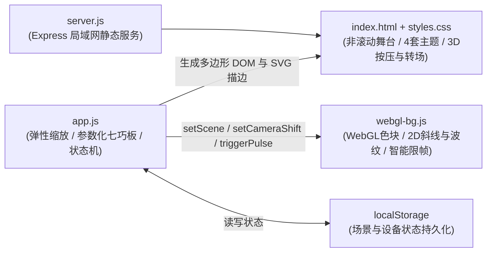

# AETHER 智能家居 Web 控制台 · 设计与架构文档

> 本文档整理了 **AETHER 智能家居纯前端 Web 控制台** 的功能需求、视觉与交互设计要点、iPad 跨分辨率自适应与移动端性能优化策略，以及当前代码结构，供设计评审与后续对接真实智能家居后端（如 Home Assistant / MQTT）参考。

---

## 1. 项目概述

- **定位**：面向家庭中控场景（最终运行于 **iPad 横屏**，兼容 iPhone 与桌面浏览器）的纯前端智能家居交互控制台原型。
- **技术栈**：原生 `HTML5 + CSS3 + Vanilla JS + WebGL`，零构建工具依赖；本地调试采用 `Node.js + Express` 静态托管（支持局域网移动设备访问）。
- **核心设计基调**：以《底特律：变人》的极简仿生白灰几何美学为基础，突破传统方正网格，采用**七巧板大斜线相交拼合布局**与纯触屏 3D 按压反馈；并在「酷炫」模式下融入《赛博朋克 2077》夜之城高对比霓虹配色。

---

## 2. 功能需求

### 2.1 一级主控台（HUB）

1. **中枢状态展示（巨型视觉焦点块）**
   - 实时时钟、室内温度、当前安防态（居家 / 警戒中）。
   - 当前激活场景大字标题与实时总功耗（W）估算。
   - **全场唯一的同心三角旋转呼吸核心动画**，作为整个家庭中枢的视觉锚点。
2. **空间场景一键切换（4 种模式）**
   - **明亮（DAYLIGHT）**：纯净冷白灰主调；客厅/卧室主灯高亮、窗帘全开、空调 23.5°C。
   - **温馨（WARM）**：暖白灰石膏色调；色温降至 2700~2900K 柔光、氛围灯带增强、窗帘微闭。
   - **酷炫（COOL · 2077）**：《赛博朋克 2077》夜之城配色（深墨黑底 + 赛博黄激活块 + 电子青核心 + 霓虹赤红切边）；氛围灯带 100% 冷光、主灯压暗。
   - **熄灯（LIGHTS OUT）**：低眩光月岩灰夜视态；全屋照明关闭、窗帘全闭、空调转 25.5°C 静音睡眠。
3. **核心电器组控制（5 组高频设备）**
   - 覆盖 **客厅主灯、卧室灯、氛围灯带、全屋窗帘、中央空调**。
   - 点击板块直接切换开关；点击板块右上角「精调 ▸」进入对应设备的二级调参视图。
   - 板块内置精简数值读数与细进度条，开关与数值变更均带缓动过渡。
4. **底部快捷入口条**
   - **精细调参**：跳转二级调参菜单。
   - **安防与定时**：跳转二级安防与自动化菜单。
   - **全屋休眠**：一键触发「熄灯」场景。

### 2.2 二级菜单（支持全缓动转场与返回）

1. **精细调参视图（Inspector）**
   - 顶部支持一键切换所有设备，左上角提供「◁ 返回」按钮（桌面端同步支持 `ESC` 键）。
   - 左侧展示大号状态读数、实时功耗与整块开关。
   - 右侧提供专为触屏设计的**超宽大斜切滑块**（灯光支持亮度 + 色温双滑块、窗帘支持开合度、空调支持 0.5°C 步进温控）及 4 档快速预设按钮。
2. **安防与定时视图（Automation）**
   - **全屋安防**：一键切换「居家态 / 离家警戒布防中」，并同步更新主中枢状态。
   - **睡眠倒计时熄灯**：支持 `15 / 30 / 60 分钟` 与取消定时，倒计时归零自动切换至「熄灯」场景。
   - **全屋一键同步宏**：全屋照明全开、窗帘一键闭合/全开、离家节能布防（同步熄灯闭帘并开启警戒）。
3. **状态持久化**
   - 所有场景、设备开关、亮度/色温/温度与安防状态自动持久化至 `localStorage`，刷新不丢失。

---

## 3. 视觉与交互设计要点

### 3.1 极简与配色体系

| 场景模式 | 主调风格 | 基底色 | 激活态板块 | 3D 挤出底座 | 呼吸与核心色 |
| --- | --- | --- | --- | --- | --- |
| 明亮 (`bright`) | 极简冷白灰 | `#EEF1F5` | 石墨灰 `#1E242E` | `#C5CEDB` / `#0E1219` | 冷岩青 `#436485` |
| 温馨 (`warm`) | 暖灰石膏 | `#F2EFE9` | 深暖褐 `#332D27` | `#D6CFC4` / `#1C1814` | 浅砂棕 `#8E7458` |
| 酷炫 (`cool`) | 赛博朋克 2077 | `#0B0D14` | 赛博黄 `#FCEE0A` | `#2A0D1C` / `#FF2A6D` | 电子青 `#00F0FF` |
| 熄灯 (`night`) | 低眩光月岩灰 | `#171B21` | 浅银灰 `#DFE5EE` | `#0E1116` / `#96A2B3` | 雾银 `#B5C7DC` |

### 3.2 七巧板大斜线拼合布局

- **突破方正 Grid**：所有板块由 `computeTangramPieces(W, H)` 通过直线交点算法实时生成，相邻斜边共享同一斜率（`SLASH_SLOPE = -0.18`），横向分割线采用微倾角打破十字交点。
- **明显的大小对比**：左上巨型中枢块 + 中央大号「客厅主灯」占据视觉主体，右侧「全屋窗帘 / 中央空调 / 氛围灯带」错落咬合，左下 4 块场景与底部 3 条功能入口保持紧凑尺度。
- **呼吸留白**：舞台四周保留 `56px` 外留白、板块间切缝为 `22px`，避免大屏（如 iPad Pro）产生压迫感，同时让底层背景色块与斜线自然透出。
- **克制的动态焦点**：全页仅在主中枢保留**唯一一处**同心三角旋转呼吸核心，其余板块仅保留克制的激活态柔和呼吸微光。

### 3.3 纯触屏 3D 交互与全缓动转场

- **移除鼠标跟随**：专为触屏中控设计，彻底取消指针倾斜（tilt）与光标光泽跟踪。
- **触屏 3D 按压反馈**：每个板块由「表面多边形 `.tan-surface` + SVG 精确发丝描边 `.tan-svg` + 底层 3D 挤出厚度块 `.tan-extrude`」构成；按下时表面沿 Y 轴沉入底座并微缩（`translate3d(0, 6px, 0) scale(0.988)`），抬起弹性回弹并在触点释放空心六边形波纹。
- **一级 ↔ 二级缓动转场**：切换二级菜单时，一级七巧板各板块按各自斜向坐标错峰离散淡出，背景 WebGL 执行镜头平移（`setCameraShift`）与斜向扫光束（`triggerSweep`），二级面板从侧翼平滑切入。
- **静默反馈原则（异常才提示）**：场景切换、设备开关、定时设定与宏指令等常规操作直接通过板块状态与几何动效反馈，不再弹出底部 Toast；底部提示条 `showToast` 仅保留给断网、设备离线或后端指令失败等非正常异常情况。

### 3.4 非滚动与 iPad 跨分辨率自适应

- **严格非滚动**：锁定 `100dvw × 100dvh`、`overflow: hidden` 与 `overscroll-behavior: none`，并支持 `viewport-fit=cover` 与 `env(safe-area-inset-*)`。
- **弹性比例锁定**：以 iPad 横屏基准高度 `960px` 为参考，根据真实可视区域（读取 `visualViewport` 精确扣除 Safari 顶部地址栏高度）将逻辑宽高比弹性夹紧在 `1.28 ~ 1.66` 之间，再重新计算参数化七巧板坐标，实现 iPad Mini、iPad Air、iPad Pro 及 Safari 带顶栏模式下的布局一致性。
- **绝对居中缩放**：舞台采用 `position: absolute; left: 50%; top: 50%; transform: translate(-50%, -50%) scale(s)`，彻底避免小屏设备（如 iPad Mini）在 Grid 居中下因布局盒溢出导致的偏移与裁切。

### 3.5 移动端低温性能优化（iOS 专项）

- **消除高耗能实时模糊**：彻底移除 13 块卡片上的 `backdrop-filter: blur(...)` 与外层 `filter: drop-shadow(...)`，以高质感实体陶瓷渐变与纯几何 3D 挤出块替代，避免 iOS WebKit 每帧重采样毛玻璃导致发热。
- **WebGL 降采样与动态限帧**：WebGL 柔和背景色块以 `0.7x` 分辨率渲染并去除逐像素噪声计算；静态巡航自动限帧至约 `26fps`，仅在触发触控波纹或转场扫光时瞬时提升至 `60fps`。
- **后台自动休眠**：监听 `document.visibilitychange`，页面切至后台或锁屏时自动停止 `requestAnimationFrame` 渲染循环。

---

## 4. 代码结构

### 4.1 目录与文件清单

```text
HouseKeeper/
├── index.html      # 视口锁定容器、一级七巧板画布及两个二级菜单语义结构
├── styles.css      # 4 套场景主题变量、3D 多边形挤出与按压动效、二级转场样式
├── webgl-bg.js     # WebGL 斜切色块着色器 + Canvas 2D 斜线/波纹/扫光引擎
├── app.js          # iPad 弹性缩放、参数化七巧板几何生成、状态机与触屏交互逻辑
├── server.js       # Node + Express 本地静态服务器（0.0.0.0:3000，局域网可访问）
├── package.json    # 项目元信息与 Express 依赖声明
└── DESIGN.md       # 本文档
```

### 4.2 模块协作关系



### 4.3 核心模块职责速查

- **[index.html](file:///d:/projects/HouseKeeper/index.html)**：定义双层背景画布（`#webgl-bg`、`#lines-bg`）、固定视口容器 `.viewport-lock`、等比舞台 `#touch-stage` 以及 `#view-hub`、`#view-inspector`、`#view-automation` 三个视图节点。
- **[styles.css](file:///d:/projects/HouseKeeper/styles.css)**：通过 `body[data-scene]` 驱动全站 CSS 变量平滑过渡；通过 `body[data-view]` 与 `.stage-view.is-current` 控制一级/二级菜单的 3D 景深转场。
- **[webgl-bg.js](file:///d:/projects/HouseKeeper/webgl-bg.js)**：向外暴露 `window.AetherBG` 接口，提供 `setScene(id)`、`setCameraShift(x, y)`、`triggerPulse(x, y)`、`triggerSweep()` 四个方法，内部完成颜色插值、降采样、动态限帧与后台休眠。
- **[app.js](file:///d:/projects/HouseKeeper/app.js)**：
  - `fitStage()`：读取 `visualViewport` 计算弹性舞台宽高与居中缩放比例。
  - `computeTangramPieces(W, H)` & `buildPolygonGeometry(points)`：计算每块七巧板的精确顶点、局部 `clip-path` 与 SVG 描边坐标。
  - `renderTangramHub()` / `renderInspector()` / `syncAutomationUI()`：驱动三级视图渲染与交互事件。
- **[server.js](file:///d:/projects/HouseKeeper/server.js)**：托管根目录静态资源，关闭强缓存（`Cache-Control: no-store`），启动时自动输出本机与局域网 IPv4 访问地址。

---

## 5. 本地运行与后续扩展建议

### 5.1 启动本地预览

```bash
npm install
node server.js
```

启动后终端会打印本机（`http://localhost:3000`）及局域网地址（如 `http://192.168.x.x:3000`），同一 Wi-Fi 下的 iPad / iPhone 浏览器即可直接打开测试；在 iPad Safari 中点击「分享 → 添加到主屏幕」即可获得全屏原生中控体验。

### 5.2 后续接入真实智能家居的切入点

当前 [app.js](file:///d:/projects/HouseKeeper/app.js) 中的状态变更已集中在以下 4 个函数，后续接入 Home Assistant WebSocket API 或自建后端时，只需在这几处桥接指令发送与状态订阅即可：

1. `applyScene(sceneId)`：调用真实场景/脚本服务。
2. `toggleDevice(deviceId)`：下发设备开关指令。
3. `makeSlider(dev, spec)` 的 `change` 回调：下发亮度、色温、窗帘位置或空调目标温度。
4. `btn-security-toggle` 与 `setSleepTimer(minutes)`：对接安防布防实体与服务端定时任务。
